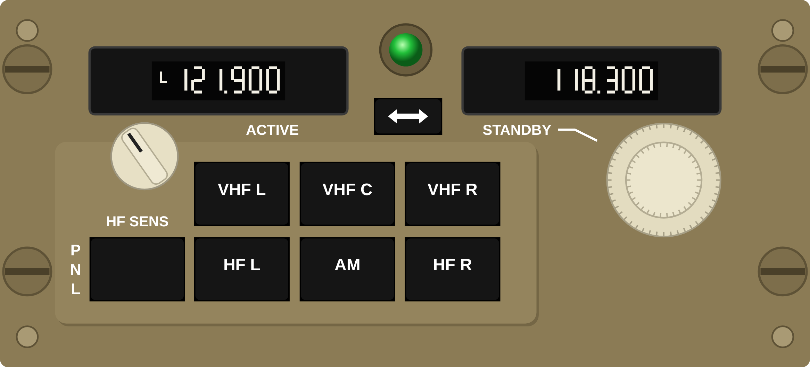

# Squawk 777 radio tuning panel

A 3D-printed replica of the Boeing 777 Radio Tuning Panel (RTP), 5.735 x 2.61 in, that plugs into an
Xbox and tunes the COM radios in Microsoft Flight Simulator 2024. It also links to the Squawk web app
over Bluetooth, so Squawk's radios follow whatever the panel shows.

No soldering. Every part plugs in or screws into a terminal.

## How it works

- The Xbox doesn't let outside programs talk to the sim, but it does accept a USB keyboard. The panel's
  ESP32-S3 board acts as a keyboard. Turning the knob or pressing the transfer button sends a key combo
  (Ctrl + Alt + Shift + a key) that you bind in MSFS to the COM radio controls.
- VHF L, VHF C and VHF R pick which radio the panel tunes: COM1, COM3 and COM2.
- The knob changes the STANDBY frequency. Push it to switch between MHz and kHz (the line under the
  digits shows which). The transfer button (the arrow) swaps ACTIVE and STANDBY.
- The Xbox can't send anything back, so the panel keeps track of the frequencies itself. It assumes the
  sim starts at the values in `firmware/settings.py`. If they ever don't match, hold the transfer
  button for 3 seconds to sync.
- In Squawk, click **Connect panel** next to RADIO PANEL. Squawk then tunes to the panel's frequencies,
  and when ATC hands you to a new frequency, the panel's STANDBY window flashes it with "ATC" for 5 seconds.
- HF L, AM, HF R, the PNL OFF switch, the HF SENS knob and the green light are look-only.
  MSFS has no HF radios.

## Folders

- `firmware/` copy everything in here to the CIRCUITPY drive (CircuitPython 9 or 10).
  `lib/` holds the Adafruit libraries (MIT licence).
- `stl/` printable parts. All fit a 180 x 180 mm bed. Print 3 `button_cap`, 4 `button_cap_dummy`,
  2 `lcd_bezel`, 2 `screen_clamp`, 4 `dzus_head`, and 1 of everything else (one tuning knob, D-shaft or knurled).
- `docs/` wiring diagram, a picture of the back of the faceplate, and the label sheet (print at 100% scale).
- `tools/` the Python scripts that make the parts, labels and diagrams. Change the numbers at the
  top of `make_parts.py` and run it again if your parts are a different size. It checks that
  everything behind the faceplate fits without touching.

## Wiring (ESP32-S3-DevKitC-1)

| Part | Pin | Board |
|---|---|---|
| ACTIVE screen (0.91 in, SSD1306) | VCC / GND / SCL / SDA | 3V3 / GND / IO9 / IO8 |
| STANDBY screen (0.91 in, upside down) | VCC / GND / SCL / SDA | 3V3 / GND / IO2 / IO1 |
| Tuning knob (KY-040) | CLK / DT / SW | IO4 / IO5 / IO6 |
| Transfer button (KY-004) | S / - | IO7 / GND |
| VHF L / VHF C / VHF R buttons (KY-004) | S / - | IO15 / IO16 / IO17, GND |
| Every + and VCC | | 3V3 (through a Wago lever connector) |
| Every GND | | GND (through two Wago lever connectors) |

## Key bindings in MSFS (Settings > Controls > Keyboard)

| Action in MSFS | VHF L (COM1) | VHF R (COM2) | VHF C (COM3) |
|---|---|---|---|
| Standby frequency whole (MHz) increase | Ctrl+Alt+Shift+5 | Ctrl+Alt+Shift+7 | Ctrl+Alt+Shift+9 |
| Standby frequency whole (MHz) decrease | Ctrl+Alt+Shift+T | Ctrl+Alt+Shift+G | Ctrl+Alt+Shift+B |
| Standby frequency fraction (kHz) increase | Ctrl+Alt+Shift+6 | Ctrl+Alt+Shift+8 | Ctrl+Alt+Shift+0 |
| Standby frequency fraction (kHz) decrease | Ctrl+Alt+Shift+Y | Ctrl+Alt+Shift+H | Ctrl+Alt+Shift+N |
| Swap active and standby | Ctrl+Alt+Shift+U | Ctrl+Alt+Shift+J | Ctrl+Alt+Shift+M |

The SDK names are `COM_RADIO_WHOLE_INC/DEC`, `COM_RADIO_FRACT_INC/DEC` and `COM_STBY_RADIO_SWAP` for
COM1, `COM2_RADIO_WHOLE_INC/DEC`, `COM2_RADIO_FRACT_INC/DEC` and `COM2_RADIO_SWAP` for COM2, and the
same with `COM3_` for COM3. The kHz controls don't carry into the MHz (118.975 goes up to 118.000),
just like in the sim. These don't overlap the
transponder panel's keys, so both panels can use the same keyboard profile.

## Edit mode

Normally the panel shows up only as a keyboard (that's what the Xbox wants). Hold the transfer button
while plugging it into your Mac and the CIRCUITPY drive appears so you can change files.
