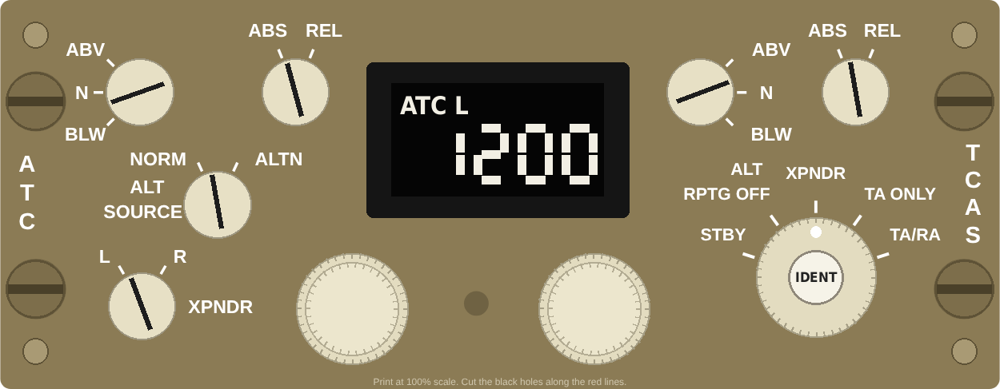

# Squawk 777 transponder panel

A 3D-printed replica of the Boeing 777 ATC/TCAS transponder panel (Gables Engineering G7131,
5.735 x 2.235 in) that plugs into an Xbox and works in Microsoft Flight Simulator 2024.
The layout, knobs and lettering follow Gables' photo of the real panel.

 It also links to the Squawk web app over Bluetooth, so ATC can
check your squawk code.

No soldering. Every part plugs in or screws into a terminal.

## How it works

- The Xbox doesn't let outside programs talk to the sim, but it does accept a USB keyboard. The
  panel's ESP32-S3 board acts as a keyboard. Turning a knob presses a key combo (Ctrl + Alt + Shift
  + a key) that you bind in MSFS to "increase/decrease transponder digit".
- The Xbox can't send anything back, so the panel keeps track of the code itself. It assumes the
  sim starts at 1200 (change this in `firmware/settings.py`). If they ever don't match, hold IDENT
  for 3 seconds to sync.
- The mode knob (STBY, ALT RPTG OFF, XPNDR, TA ONLY, TA/RA) goes to Squawk. Pushing it is IDENT,
  like the real panel. MSFS has no key events for transponder modes, so the mode doesn't change the sim.
- The six small selectors (ABV/N/BLW and ABS/REL on each side, ALT SOURCE, XPNDR L/R) turn but
  aren't wired; MSFS has no controls for them either.

## Folders

- `firmware/` copy everything in here to the CIRCUITPY drive (CircuitPython 9 or 10).
  `lib/` holds the Adafruit libraries (MIT licence).
- `stl/` printable parts. All fit a 180 x 180 mm bed. Print 4 `dzus_head`, 6 `selector_knob`,
  6 `selector_axle`, 2 code knobs, and 1 of everything else. Print `display_bezel` in black.
- `docs/` wiring diagram and the faceplate label sheet (print at 100% scale).
- `tools/` the Python scripts that make the parts, overlay and diagram. Change the numbers at the
  top of `make_parts.py` and run it again if your parts are a different size.

## Wiring (ESP32-S3-DevKitC-1)

| Part | Pin | Board |
|---|---|---|
| OLED 1.3 in (SH1106) | VCC / GND / SCL / SDA | 3V3 / GND / IO9 / IO8 |
| Left knob | CLK / DT / SW | IO4 / IO5 / IO6 |
| Right knob | CLK / DT / SW | IO15 / IO16 / IO17 |
| Mode knob | CLK / DT / SW (SW = IDENT) | IO10 / IO11 / IO13 |
| Every + and VCC | | 3V3 (through a Wago lever connector) |
| Every GND | | GND (through a Wago lever connector) |

## Key bindings in MSFS (Settings > Controls > Keyboard)

| Action in MSFS | Keys |
|---|---|
| Transponder 1000s increase / decrease | Ctrl+Alt+Shift+1 / Ctrl+Alt+Shift+Q |
| Transponder 100s increase / decrease | Ctrl+Alt+Shift+2 / Ctrl+Alt+Shift+W |
| Transponder 10s increase / decrease | Ctrl+Alt+Shift+3 / Ctrl+Alt+Shift+E |
| Transponder 1s increase / decrease | Ctrl+Alt+Shift+4 / Ctrl+Alt+Shift+R |
| Transponder ident | Ctrl+Alt+Shift+I |

The SDK names for these are `XPNDR_1000_INC`, `XPNDR_1000_DEC` ... `XPNDR_1_DEC` and
`XPNDR_IDENT_ON`.

## Edit mode

Normally the panel shows up only as a keyboard (that's what the Xbox wants). Hold IDENT (push the
mode knob) while plugging it into your Mac and the CIRCUITPY drive appears so you can change files.
